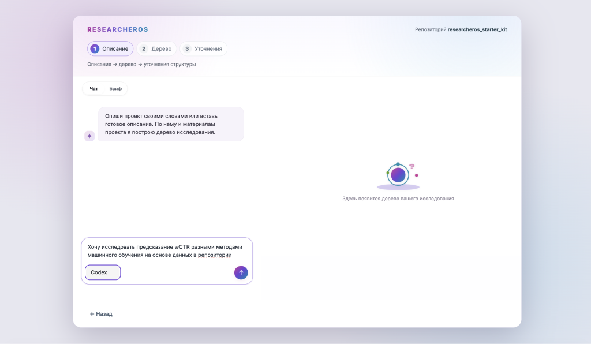
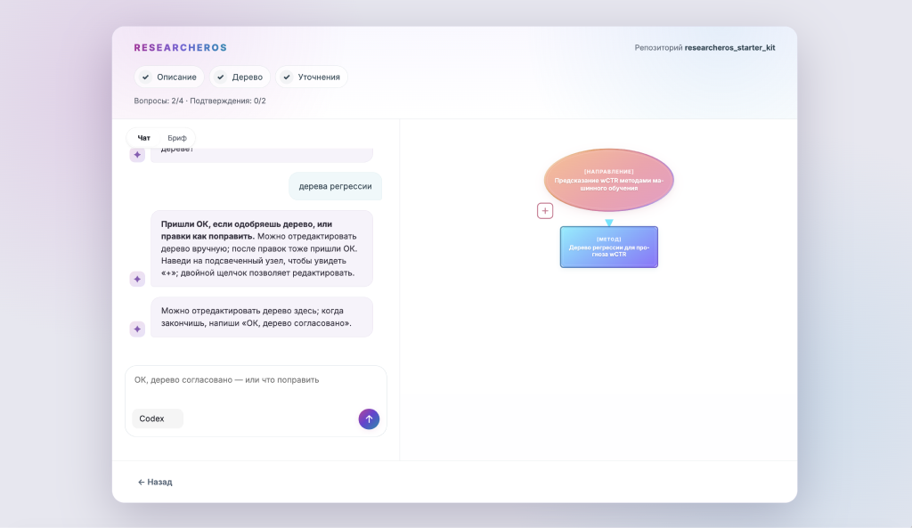
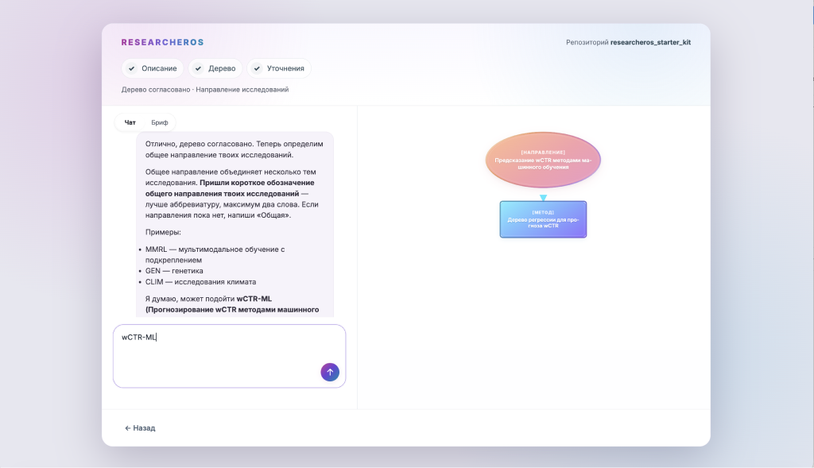
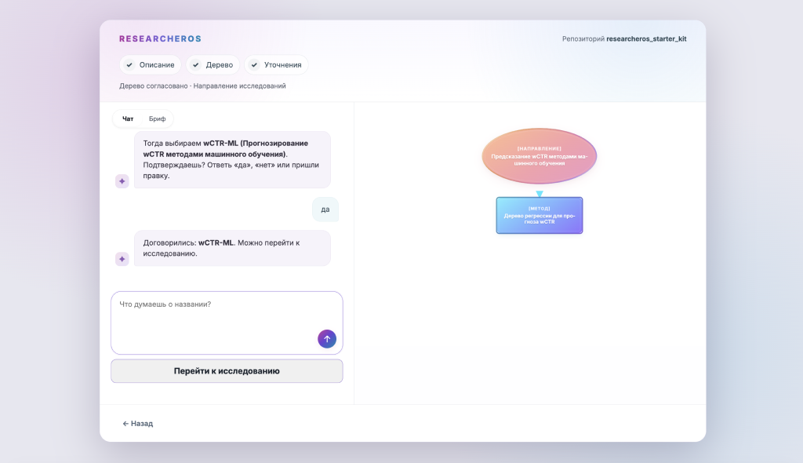

# 1. Установка и создание дерева

## Что попробуем

Подключим StarterKIT к ResearcherOS и создадим дерево исследования из описания задачи. Готовое дерево в набор не входит.

## Действия

1. Установите Git. Установите CLI-агент, который хотите использовать в ResearcherOS, и войдите в свой аккаунт. Подписка или API агента нужны отдельно; наличие приложения ResearcherOS их не заменяет.
2. Склонируйте StarterKIT. Команды ниже выполняются в терминале в папке, где вы храните проекты:

```bash
git clone --branch main https://github.com/ZoyaV/researcheros_starter_kit.git
cd researcheros_starter_kit
python scripts/check_data.py
```

На macOS / Linux, если команда `python` не найдена, используйте `python3`; на Windows можно использовать `py`. Дальше в руководстве `python` означает ваш Python 3.10 или новее.

3. Откройте [страницу релизов ResearcherOS](https://github.com/CognitiveAISystems/ResearcherOS/releases) и скачайте сборку для своего компьютера:

   - macOS с Apple Silicon (M1 и новее): DMG с `arm64` в имени.
   - macOS с Intel: DMG с `x64` в имени.
   - Windows: установщик `.exe`.
   - Linux x86_64: файл `.AppImage` (glibc 2.35 или новее, например Ubuntu 22.04).

4. Установите скачанное приложение. На macOS откройте DMG и перенесите ResearcherOS в папку «Программы». На Windows запустите EXE и следуйте шагам установщика. На Linux разрешите выполнение AppImage как программы и откройте файл. Если macOS блокирует первый запуск, разрешите его в «Системные настройки → Конфиденциальность и безопасность».

5. Откройте приложение. При первом запуске на вопрос «Подключались ли вы с этого ноутбука к ResearcherOS?» выберите «Нет».

   

   Затем нажмите «Выбрать репозиторий» и выберите папку `researcheros_starter_kit`, не папку `data`. Если вы уже работаете в приложении, используйте создание нового дерева и выберите тот же репозиторий.

   

6. В мастере создания дерева выберите установленного агента. Вставьте описание исследования в чат и отправьте его:

   ```text
   Хочу исследовать методы прогнозирования взвешенной доли кликов (wCTR)
   при несбалансированной выборке с большим количеством нулей в целевой
   метрике методами машинного обучения для регрессии, к примеру с помощью
   алгоритмов на базе деревьев решений.
   ```

   

7. Ответьте на уточняющие вопросы агента. Когда появится дерево, проверьте его: при необходимости попросите агента внести изменения или отредактируйте узлы вручную. Когда дерево будет готово, напишите в чате «ОК, дерево согласовано».

   

8. Укажите короткое название направления исследования, например `wCTR-ML`. Проверьте предложенное название и подтвердите его в чате. Затем нажмите «Перейти к исследованию».

   

   

## Проверка результата

- [ ] StarterKIT подключён к ResearcherOS.
- [ ] Дерево исследования создано и согласовано.
- [ ] Направление исследования названо и подтверждено.
- [ ] На главном экране видно дерево с методами и канбаном.
- [ ] В дереве нет выдуманных результатов и отметок об успешных экспериментах.
