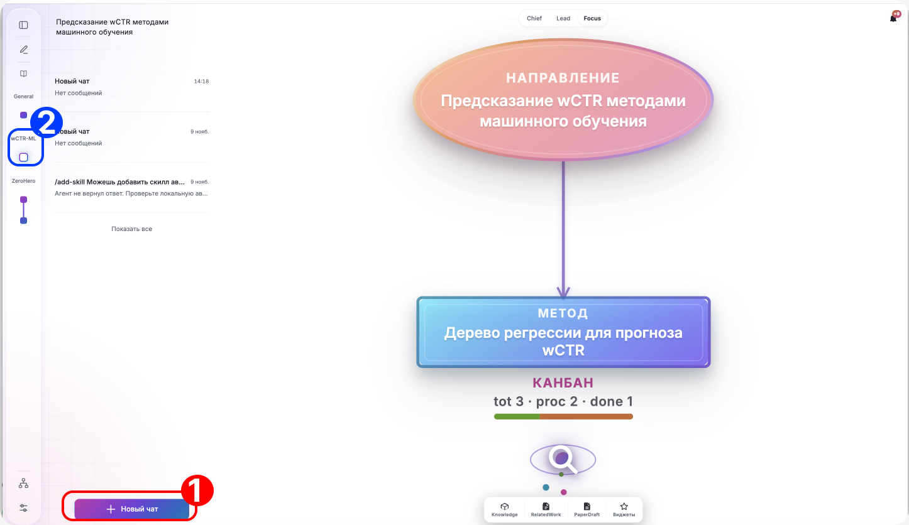
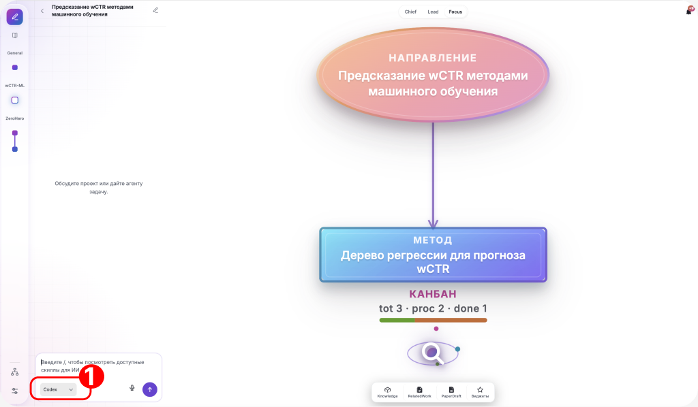
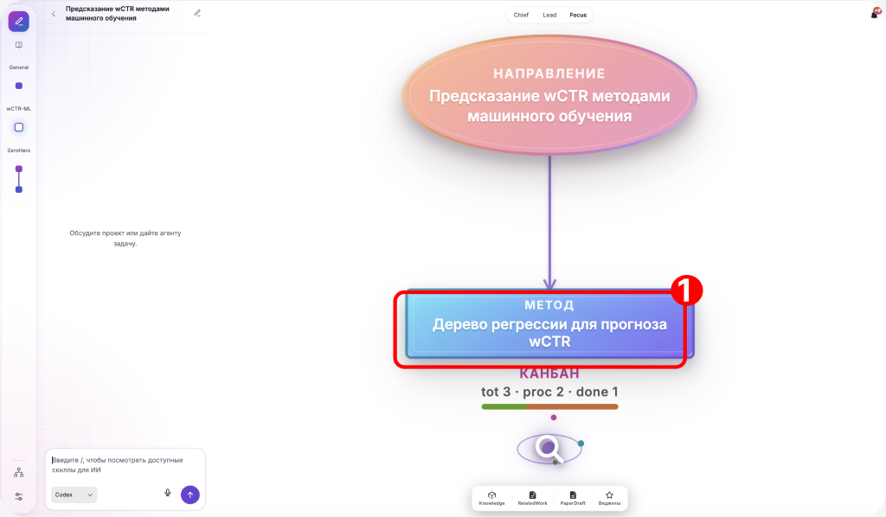
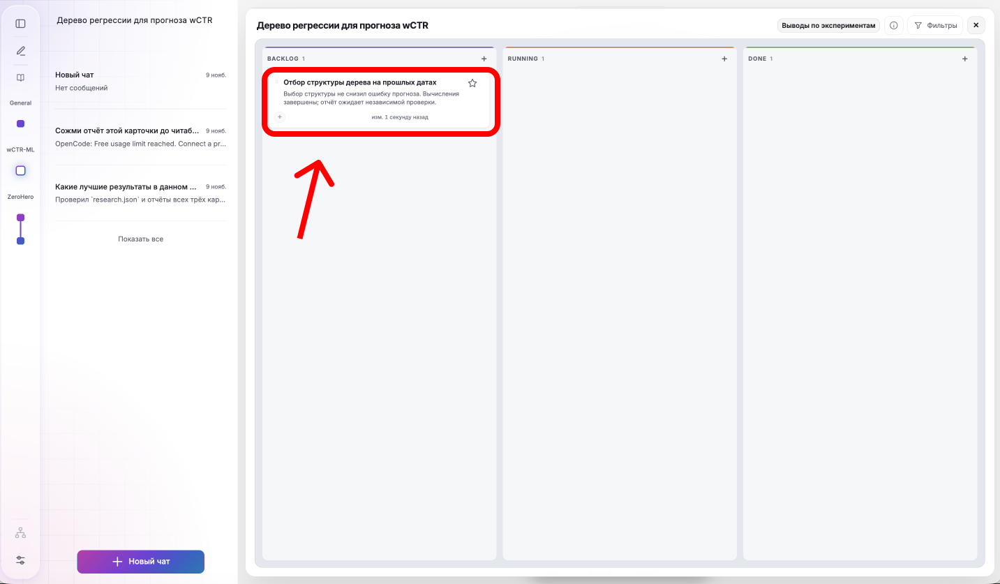

# 2. Проверка дерева и первая карточка

## Что попробуем

Посоветуемся с агентом о первом эксперименте и добавим карточку в канбан метода.

## Действия

1. Выберите созданное дерево в боковой навигации и найдите на полотне метод.

2. Откройте боковой чат и нажмите «Новый чат».

   

3. В чате выберите установленного CLI-агента.

   

4. Отправьте агенту сообщение:

   ```text
   Посоветуй первый небольшой эксперимент для CPU:
   постоянный средний прогноз против неглубокого дерева регрессии
   по data/README.md и неизменному data/protocol.json.
   ```

5. Попросите агента добавить карточку предложенного эксперимента в канбан подходящего метода.

6. Нажмите на метод на полотне, чтобы открыть его канбан. Проверьте, что в колонке backlog появилась карточка эксперимента.

   

   

## Проверка результата

- [ ] Агент предложил первый эксперимент.
- [ ] В канбане подходящего метода в колонке backlog появилась карточка эксперимента.
