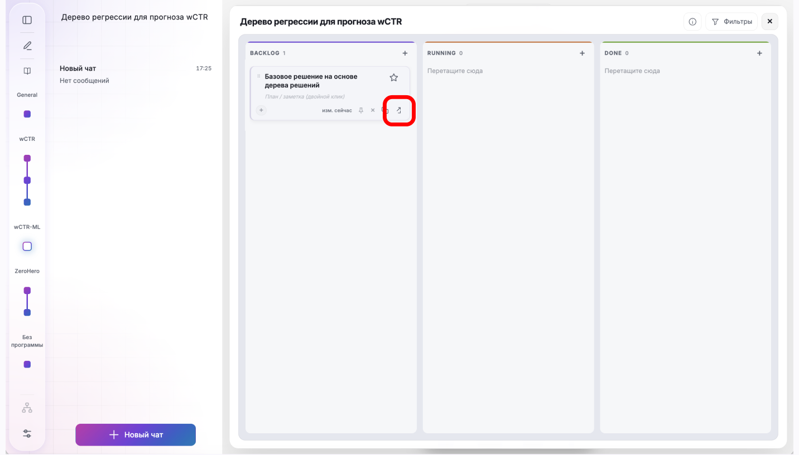
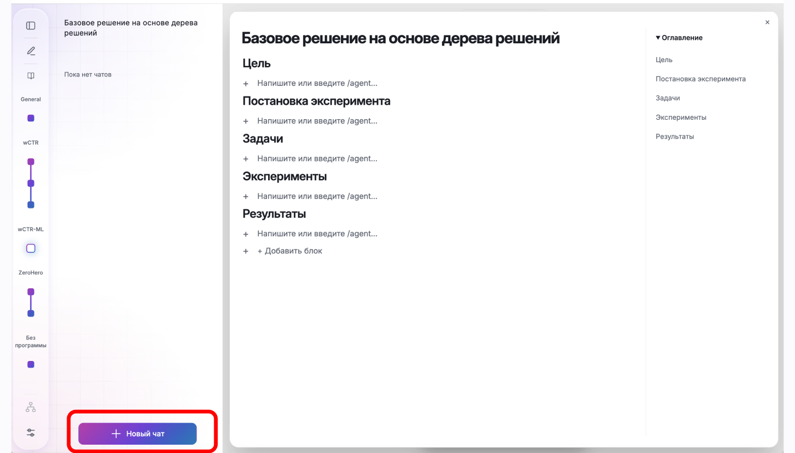
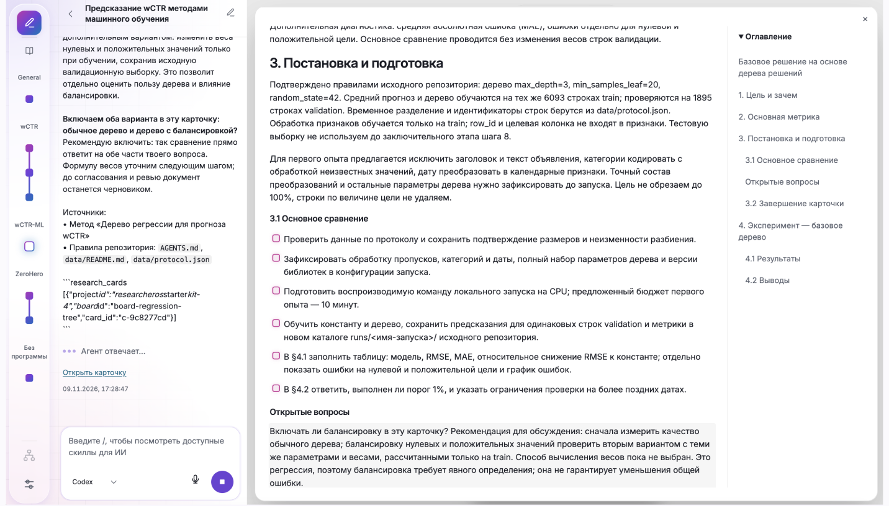

# 3. Подробная постановка карточки

## Что попробуем

Откроем карточку и уточним с агентом постановку эксперимента до запуска.

## Действия

1. В канбане найдите карточку эксперимента в колонке backlog и нажмите значок открытия карточки.

   

2. В открывшемся отчёте нажмите «Новый чат», чтобы обсудить постановку с агентом в контексте карточки.

   

3. Отправьте агенту сообщение. Отвечайте на его вопросы и согласуйте постановку эксперимента.

   ```text
   Уточни постановку этой карточки по её краткому описанию.
   Прочитай data/README.md и data/protocol.json. До запуска заполни
   в отчёте цель, основную метрику, правило вывода и подготовку.
   Первое сравнение: константа среднего train и дерево регрессии
   max_depth=3, min_samples_leaf=20, random_state=42.
   Главная метрика - RMSE; MAE и ошибки на нулевых/положительных
   значениях используй только для диагностики.
   Критерий: проверочная RMSE хотя бы на 1% ниже константы.
   Признаки и временное разделение фиксированы; test пока не трогать.
   Обработку категорий обучай только на train, неизвестные категории
   обрабатывай корректно. Текст можно исключить в первом опыте,
   но запиши это ограничение. Не используй row_id как признак.
   Предусмотри локальное окружение, воспроизводимую команду,
   чеклист подзадач, таблицу результатов и график ошибок для монитора.
   Ограничь первый опыт 10 минутами на CPU, без GPU и облака.
   Запуск - отдельным сообщением /run после окончания постановки.
   ```

4. Проверьте подготовленный отчёт: прочитайте цель, метрику, критерий результата и план. Если что-то непонятно или не совпадает с договорённостями, попросите агента уточнить и исправить отчёт.

   

## Проверка результата

- [ ] В отчёте указаны цель эксперимента, метрика RMSE и порог улучшения.
- [ ] Описаны выборки, модели и обработка признаков.
- [ ] Указаны команда запуска, бюджет и подзадачи.
- [ ] Карточка ещё не выполняется; в отчёте нет выдуманных результатов.
