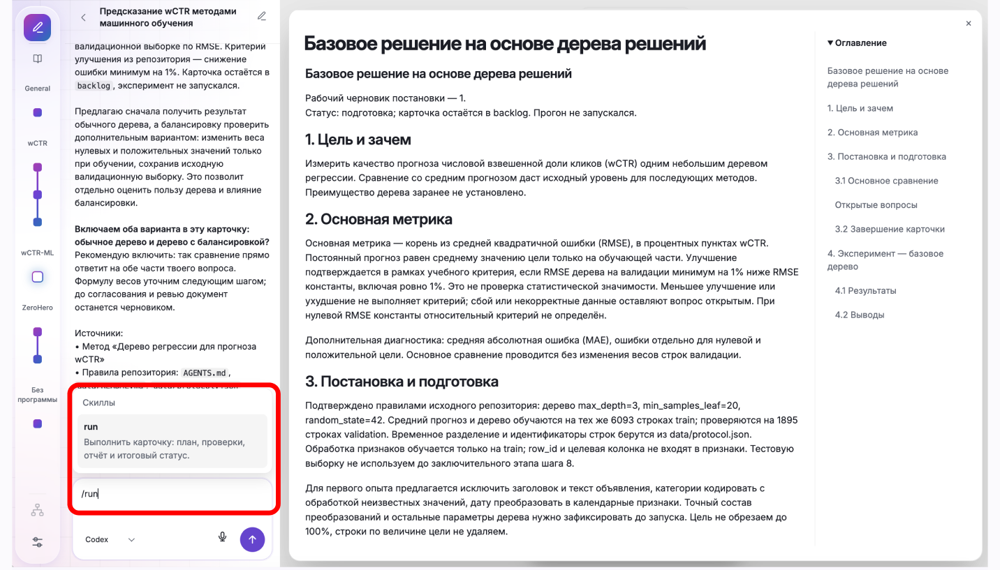
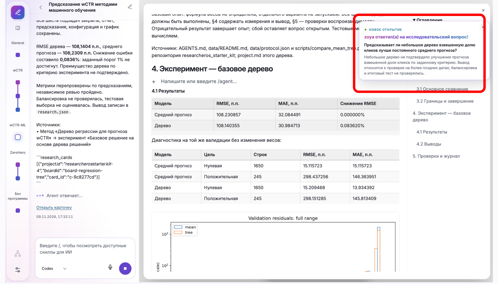
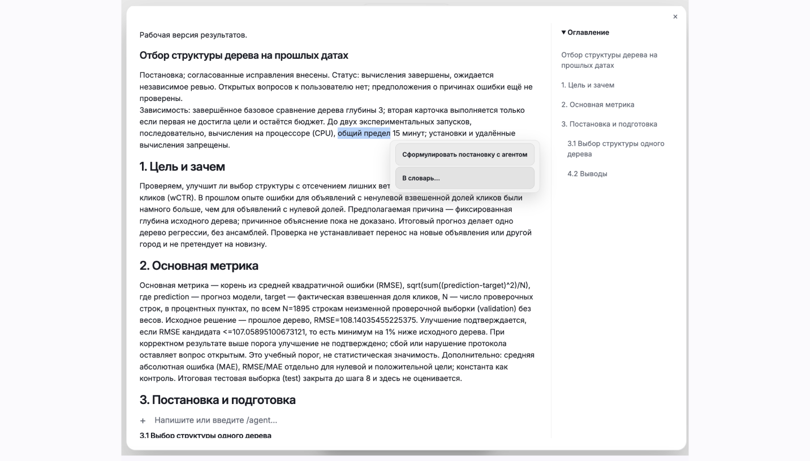
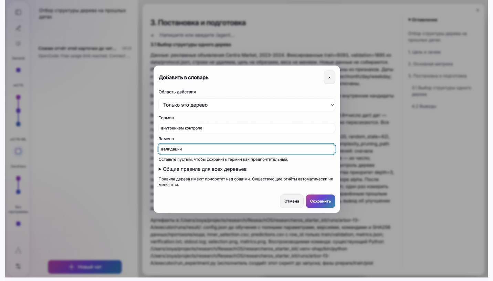
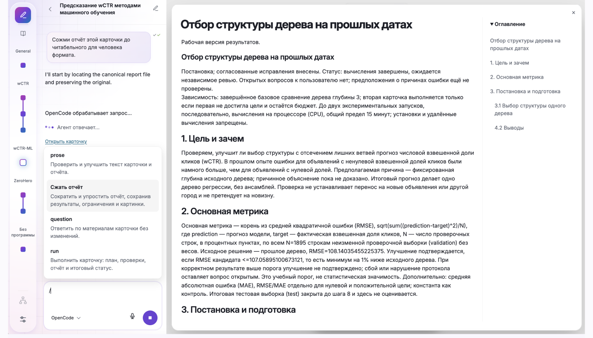

# 4. Запуск эксперимента и работа с отчётом

## Что попробуем

Запустим согласованный эксперимент, посмотрим результаты и попробуем изменить текст отчёта.

## Действия

1. Находясь в карточке, вызовите `/run` в её чате и отправьте команду агенту.

   

2. Дождитесь завершения работы агента и прочитайте отчёт карточки: результаты, метрики и выводы.

   

3. Попробуйте добавить правило для словаря: выделите в отчёте слово или выражение, которое хотите заменить, и нажмите «В словарь…».

   

   Укажите предпочтительную замену, выберите область действия правила и нажмите «Сохранить». Правило поможет агенту использовать выбранные слова в следующих отчётах; существующие отчёты автоматически не изменятся.

   

4. Чтобы улучшить текст отчёта, вызовите в чате карточки `/compact`. Дождитесь ответа агента и проверьте, что результаты, ограничения и смысл выводов сохранились.

   

## Проверка результата

- [ ] Эксперимент завершён и результаты записаны в отчёт.
- [ ] Результаты и выводы прочитаны.
- [ ] Правило для слова или выражения добавлено в словарь.
- [ ] Отчёт обработан с помощью `/compact`, а его смысл и результаты проверены.
