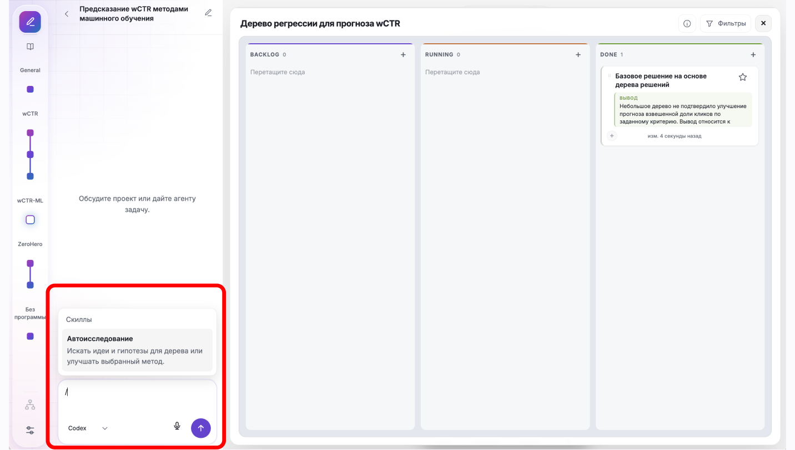
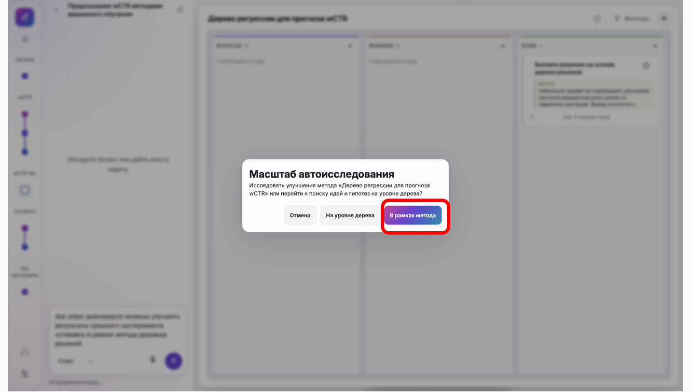
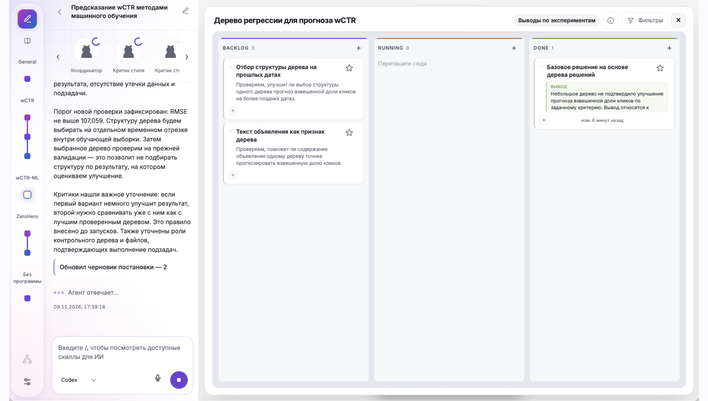
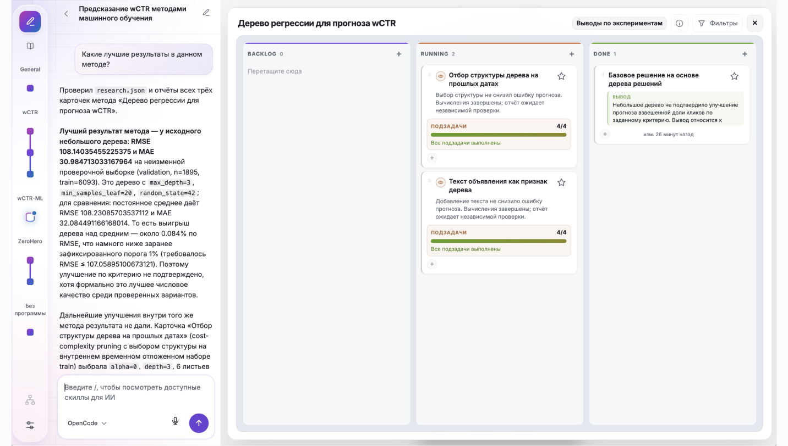

# 5. Автоисследование: улучшение метода

## Что попробуем

Запустим ограниченное автоисследование внутри выбранного метода и сравним результаты экспериментов.

## Действия

1. Дождитесь завершения первого эксперимента. Откройте канбан метода и его чат.

2. Введите `/` и выберите скилл «Автоисследование».

   

3. Добавьте к выбранному скиллу поясняющий текст и отправьте сообщение:

   ```text
   Улучши выбранный метод дерева регрессии
   по итогам первой карточки. Масштаб - только этот метод.
   Прочитай его отчёты и зафиксируй исходную проверочную RMSE.
   Предложи проверяемые гипотезы улучшения, например другую глубину
   или размер листа; не создавай конкурирующие методы в дереве.
   Сначала опубликуй гипотезы и карточки опытов в канбане метода,
   подготовь постановки, затем выполняй их по очереди.
   Протокол, признаки и разделение не меняй. Test не оценивай.
   Успех: RMSE validation хотя бы на 1% ниже лучшего ранее
   проверенного решения; если оно всё ещё константа, скажи об этом.
   Бюджет: до 15 минут и не более двух экспериментальных запусков,
   один одновременно; только CPU, без GPU и облака.
   Обновляй монитор реальными графиками. По завершении сохрани
   сравнение с прошлым результатом, выводы и причину остановки.
   ```

4. В окне «Масштаб автоисследования» выберите «В рамках метода». Если приложение предложит настройки запуска, согласуйте их с бюджетом: до 15 минут, не более двух последовательных запусков на CPU.

   

5. Следите за работой агента в чате и за новыми карточками в канбане. Прочитайте предложенные гипотезы и постановки.

   

6. Дождитесь завершения автоисследования. Проверьте статусы карточек, их отчёты, метрики и выводы.

   

7. В чате канбана спросите агента, какой эксперимент дал лучший результат, и попросите сводную таблицу:

   ```text
   Какой эксперимент в этом методе дал лучший результат?
   Составь сводную таблицу завершённых экспериментов: название,
   проверенный вариант, RMSE на validation и сравнение с исходным
   решением. Укажи, достигнуто ли улучшение на 1%, и дай ссылки
   на отчёты. Если данные несопоставимы или эксперимент не завершён,
   отметь это. Тестовую выборку не оценивай.
   ```

## Проверка результата

- [ ] Автоисследование завершено в рамках выбранного метода и согласованного бюджета.
- [ ] Новые карточки, их результаты и выводы проверены.
- [ ] Агент показал сводную таблицу и назвал лучший результат среди сопоставимых экспериментов.
